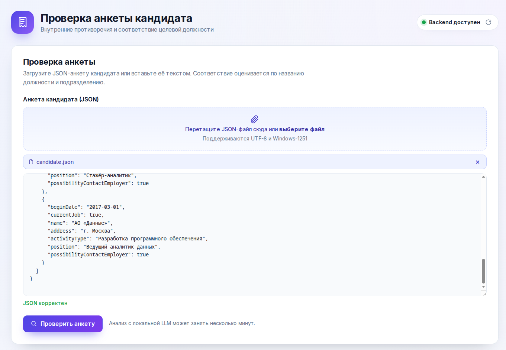
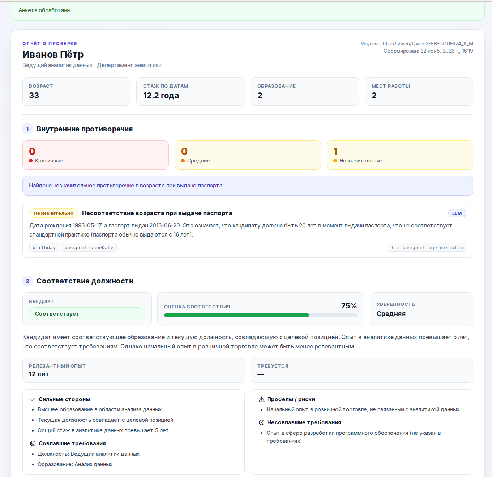
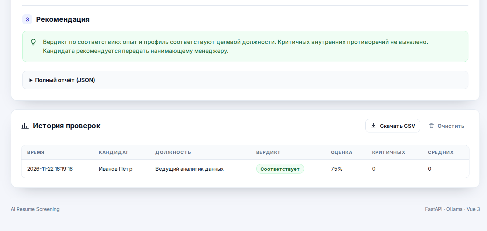

# AI Resume Screening

Сервис проверки анкеты кандидата. На вход принимается **анкета в формате JSON**
(схема заказчика), на выходе формируется структурированный отчёт:

1. **Внутренние противоречия анкеты** — несогласованные даты, возраст и стаж,
   флаги документов, пересечения периодов обучения, несоответствие заявленной
   должности содержанию опыта.
2. **Соответствие опыта целевой должности** — насколько карьерный трек, опыт и
   образование кандидата отвечают целевой должности и подразделению из анкеты.
3. **Итоговая рекомендация** — можно ли передавать кандидата нанимающему
   менеджеру или требуется ручная проверка.

Проверка противоречий гибридная: объективные несоответствия ищутся
детерминированными правилами, смысловые — локальной LLM через
[Ollama](https://ollama.com).

---

## 🏗️ Архитектура

```
Vue 3 + Vite UI (:5173 в dev, :8000 после сборки)
        │  POST JSON { candidate }
        ▼
FastAPI backend (:8000)
        │
        ├── app/checks.py                  → формальные проверки (без LLM)
        ├── contradiction_agent            → смысловые противоречия (LLM)
        └── fit_agent                      → соответствие должности (LLM)
                │
                ▼
        Ollama (локальная LLM :11434)
```

Фронтенд — отдельное SPA на Vue 3 + TypeScript + Vite. В режиме разработки
Vite проксирует запросы `/screening` и `/health` на FastAPI. Собранное
приложение (`frontend/dist`) FastAPI автоматически раздаёт на `/`, поэтому для
production достаточно одного backend-процесса.

---

## 📥 Входные данные

Особенности приёма:

- имена полей принимаются как в `camelCase` (как в схеме), так и в `snake_case`;
- лишние поля не отбрасываются;
- пустые строки и `null` в необязательных полях допустимы;
- даты понимаются в форматах `ГГГГ-ММ-ДД`, `ДД.ММ.ГГГГ`, `ГГГГ-ММ`, `ГГГГ`.

В интерфейсе анкету можно загрузить файлом (UTF-8 или Windows-1251) либо
вставить текстом. Если в JSON есть обёртка `{"candidate": {...}}`, она
разворачивается автоматически.

Соответствие должности оценивается только по названию должности
(`positionName`) и подразделению (`department`) из анкеты.

---

## 📤 Отчёт

```json
{
  "generated_at": "2026-11-22T13:00:00",
  "model": "Qwen3-8B-GGUF:Q4_K_M",
  "candidate": {
    "full_name": "Иванов Пётр",
    "position_name": "Ведущий аналитик данных",
    "department": "Департамент аналитики",
    "age": 33,
    "career_start": "2014-09-01",
    "career_span_years": 12.2,
    "has_job": true,
    "education_count": 2,
    "experience_count": 2
  },
  "contradictions": {
    "has_contradictions": true,
    "counts": { "high": 1, "medium": 2, "low": 0 },
    "items": [
      {
        "severity": "high",
        "code": "experience_0_too_early",
        "title": "Работа началась в слишком раннем возрасте",
        "description": "…",
        "fields": ["experience[0].beginDate", "birthday"],
        "source": "rule"
      }
    ],
    "summary": "…"
  },
  "fit": {
    "verdict": "partially_suitable",
    "score": 72,
    "summary": "…",
    "strengths": ["…"],
    "gaps": ["…"],
    "matched_requirements": ["…"],
    "unmatched_requirements": ["…"],
    "relevant_experience_years": 12.2,
    "required_experience_years": 3.0,
    "confidence": "high"
  },
  "recommendation": "…",
  "analysis_errors": []
}
```

- `contradictions.items[].source` — `rule` (детерминированная проверка) или
  `llm` (смысловое противоречие).
- `fit.verdict` — `suitable`, `partially_suitable`, `not_suitable` или
  `unknown`, если LLM недоступна.
- `analysis_errors` — сбои LLM-этапов; отчёт при этом всё равно возвращается
  с результатами формальных проверок.

Интерфейс показывает отчёт по секциям, позволяет скачать полный JSON, а также
ведёт историю проверок в `localStorage` с экспортом в CSV.

---

## 🚀 Запуск

### Требования

- Python 3.14+
- [uv](https://docs.astral.sh/uv/)
- [Node.js](https://nodejs.org/) 22+ и [Bun](https://bun.sh/)
- [Ollama](https://ollama.com)

### 1. Загрузка и запуск модели

```bash
ollama run hf.co/Qwen/Qwen3-8B-GGUF:Q4_K_M
ollama serve
```

### 2. Конируем репозиторий

```bash
git clone https://github.com/waldesem/ai-resume-screening.git
cd ai-resume-screening
```

### 3. Установка Python-зависимостей

```bash
cd backend
uv sync
source .venv/bin/activate # .venv/bin/Activate.ps1
```

### 4. Запуск backend

```bash
uv run uvicorn app.main:app --reload
```

Backend доступен на **<http://localhost:8000>**.

### 5. Запуск фронтенда в режиме разработки

Через Bun:

```bash
cd frontend
bun install
bun run dev
```

Откройте **<http://localhost:5173>**. Vite проксирует `/screening` и `/health`
на backend, поэтому CORS для dev-режима не требуется.

### 6. Production-сборка

```bash
cd frontend
bun run build
```

После сборки FastAPI при следующем старте увидит `frontend/app/static` и начнёт
раздавать интерфейс на **<http://localhost:8000>**:

```bash
uv run uvicorn app.main:app --host 0.0.0.0 --port 8000
```

---

## 🔌 API

### `POST /screening/`

```bash
curl -X POST http://localhost:8000/screening/ \
  -H "Content-Type: application/json" \
  -d '{
    "candidate": { "...": "анкета по схеме" }
  }'
```

### `GET /health`

```bash
curl http://localhost:8000/health
```

---

## 🧩 Что проверяют формальные правила

- обязательные поля (ФИО, должность, подразделение, дата рождения);
- возраст и правдоподобность дат (рождение, статус, паспорт, обучение, работа);
- корректность ИНН (10/12 цифр) и СНИЛС (11 цифр);
- формат e-mail и телефона;
- хронологию обучения: обратный порядок лет, будущие даты, слишком раннее
  начало, пересечение периодов;
- хронологию опыта: будущие даты начала, работу до 14 лет, стаж больше
  возможного для возраста.

Смысловые противоречия (несоответствие должности содержанию опыта, сферы
деятельности, уровня ответственности) ищет LLM-агент.

---

## ⚙️ Конфигурация

### Backend

| Переменная        | Назначение                                                     | По умолчанию                                  |
| ----------------- | -------------------------------------------------------------- | --------------------------------------------- |
| `OLLAMA_MODEL`    | модель Ollama                                                  | `llama3.2`                                    |
| `CORS_ORIGINS`    | дополнительные origin для браузера (через запятую)             | `http://localhost:5173,http://127.0.0.1:5173` |
| `ENABLE_API_DOCS` | включает `/docs` и `/redoc` (загружают Swagger UI/ReDoc с CDN) | `0`                                           |

Дополнительно backend принимает любые `http://localhost:*` и
`http://127.0.0.1:*` origin.

### Frontend

Переменные задаются в `frontend/.env` (шаблон — `frontend/.env.example`).

| Переменная           | Назначение                                             | По умолчанию            |
| -------------------- | ------------------------------------------------------ | ----------------------- |
| `VITE_API_BASE_URL`  | прямой адрес backend; пусто — same-origin / Vite proxy | пусто                   |
| `VITE_BACKEND_PROXY` | куда Vite проксирует `/screening` и `/health`          | `http://localhost:8000` |

---

## 📁 Структура проекта

```
backend/
└── app/
    ├── agents/
    │   ├── contradiction_agent.py  # смысловые противоречия (LLM)
    │   ├── fit_agent.py            # соответствие должности (LLM)
    │   └── screening_agent.py      # оркестратор отчёта
    ├── main.py                     # FastAPI + раздача frontend/dist
    ├── models/
    |   ├── llm.py                  # обёртка Ollama
    |   └── prompts.py              # промпты
    ├── schema/
    |   └── schemas.py              # Pydantic-модели анкеты
    ├── static/                     # файлы фронтенда после `bun run build`
    └── tools/
        ├── checks.py               # формальные проверки анкеты
        └── utils.py                # даты, стаж, сводка для LLM

frontend/
├── src/
│   ├── components/
│   │   ├── AppIcon.vue             # inline SVG-иконки
│   │   ├── ScreeningForm.vue       # загрузка анкеты
│   │   ├── ReportView.vue          # отчёт целиком
│   │   ├── ContradictionsPanel.vue
│   │   ├── FitPanel.vue
│   │   └── HistoryPanel.vue
│   ├── composables/useHistory.ts
│   ├── utils/                      # парсинг JSON, формат, экспорт
│   ├── api.ts                      # клиент FastAPI
│   ├── types.ts
│   ├── App.vue
│   └── main.ts
├── index.html
├── package.json
├── public/
│   └── favicon.svg                 # локальная иконка вкладки
├── tsconfig.json
└── vite.config.ts

examples/
├── candidate.json              # корректная анкета
└── candidate_with_contradictions.json
```

## Screenshot




